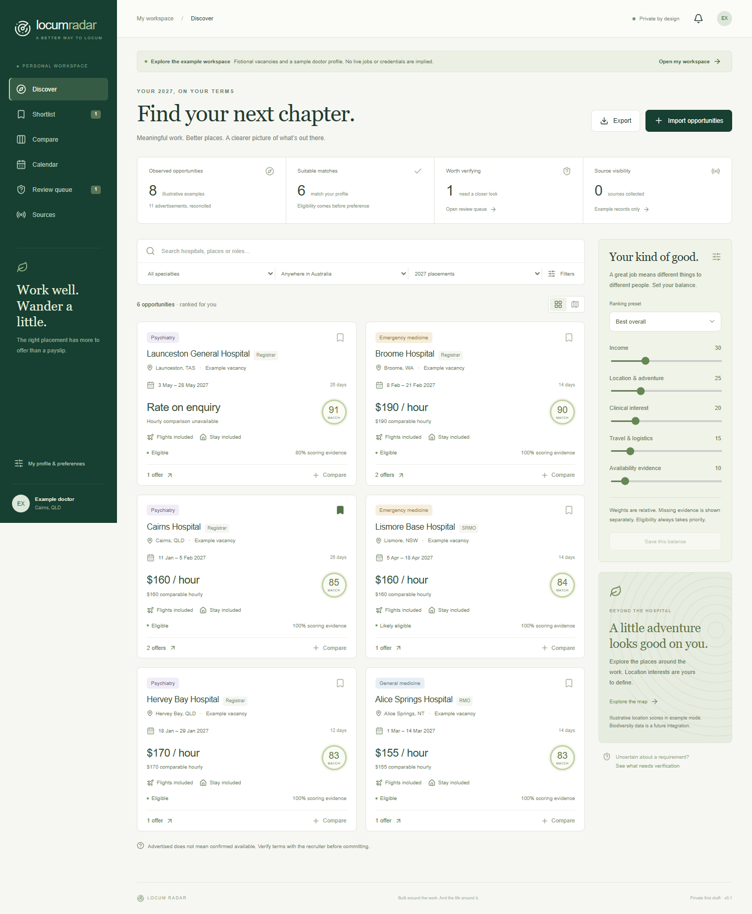

# Locum Radar

A private workspace for finding and comparing Australian medical locum opportunities, with 2027 planning as the initial focus.

**First draft, not a live national job aggregator.** The interface, database, reviewed imports, eligibility engine, deterministic ranking, reconciliation, comparisons, tracker and calendar work locally. Public collectors are disabled and have not been qualified against live boards. No email account, calendar account, hosted service or paid AI service is connected.



## Start here

Install **Node.js 24 or newer**, then run:

```sh
npm ci
npm run dev
```

Open **http://127.0.0.1:3000**. The server binds only to your computer's loopback interface. No account or API key is needed for local use.

1. Explore the **example workspace**. All of its jobs, rates and qualifications are fictional. Examples never enter your database.
2. Choose **Open my workspace**, then **My profile & preferences**. Registration, grade and supervision start unknown; the app does not infer your professional eligibility.
3. Choose **Import opportunities**. Paste an advertisement, upload a `.txt`, `.html`, `.eml` or `.json` file, and review before saving. Choose the correct source.
4. Use **Review queue** for unknown requirements and possible duplicate matches. Save interesting jobs, compare up to four, and keep recruiter questions in private notes.

See [the import guide](docs/importing.md) for supported fields. Free-form extraction recognises a limited set of explicit patterns; arbitrary recruiter formats and attachments still require review or transcription.

## What works

- Separate facilities, underlying opportunities, source advertisements, recruiter offers and observation history.
- Exact matching only with matching facility/role/dates, nonempty shared reference and roster, and consistent requirements. Ambiguous matches go to review. Reviewed merges can be undone by separating an offer.
- Five eligibility categories; explicit credential, grade, supervision, availability and exclusion checks.
- Hourly/day/shift/placement terms, paid units, super, on-call treatment, personal expenses and temporary cost scenarios. Unknown numbers stay unknown.
- Six ranking presets and adjustable weights. Missing criteria are omitted and remaining weights normalised. Scoring evidence is displayed separately. Withdrawn offers remain in history and are excluded from ranking.
- Search and filters, shortlist, side-by-side comparison, 2027 placement timeline with overlaps, schematic geographic explorer, small starter facility directory, source registry and source health history.
- Application stages, notes, deletion of imported opportunity records, CSV export with spreadsheet-formula escaping.
- SQLite persistence by default; optional PostgreSQL connection using the same repository contract and schema.
- Password-protected sessions when configured; strict mutation-origin checking and read protection on every data endpoint.
- A disabled-by-default structured-page collector framework with a fixed hostname allowlist, recorded access review, conservative robots handling, validated/pinned public IP, bounded response size, timeout, retry, durable collection interval and an extraction review queue.

## Important boundaries of this draft

- **The Phase 1 live-collection exit criterion is not yet met.** Synthetic examples and tested imports do not prove live multi-source discovery. Source-specific adapters need permitted access, captured real fixtures and validation.
- `.eml` imports read the message body; attachments, Gmail/Outlook OAuth and background mailbox sync are not implemented. No mailbox was read during this build.
- No managed scheduling, automatic notifications, calendar sync, national facility dataset, map tiles, biodiversity integration, travel routing, adaptive learning or automatic applications.
- Calendar entries represent placement dates, not individual rostered shifts. The map is labelled schematic; new facilities without coordinates remain in its list.
- No tax calculations, credential certification, fellowship equivalence or guarantees of vacancy availability.
- PostgreSQL support is implemented but has not been exercised against a real PostgreSQL server in this environment. SQLite is the validated local backend.
- The application has one owner. Separate friend accounts, MFA and per-user authorisation are future work. Do not treat the current owner session as a multi-user system.

## Configuration and data

Copy `.env.example` to `.env.local` if you need to change settings. Keep that file out of Git.

| Setting             | Purpose                                                             |
| ------------------- | ------------------------------------------------------------------- |
| `APP_ORIGIN`        | Exact browser origin; default `http://127.0.0.1:3000`               |
| `APP_PASSWORD`      | Optional local password; at least 16 characters for a remote origin |
| `SESSION_SECRET`    | 32+ random characters; required whenever a password is set          |
| `SQLITE_PATH`       | Default `./data/locum-radar.sqlite`                                 |
| `DATABASE_URL`      | Optional dedicated PostgreSQL database; overrides SQLite            |
| `COLLECTOR_ENABLED` | Global collection gate; default false                               |

All local records are under `data/`, which is excluded from Git. There is no browser local-storage copy of your imported advertisements. For a consistent SQLite backup, stop both the app and collectors before copying the database, or use SQLite's online backup tooling; do not copy only the main file while WAL writes are active. Exported CSV contains your job summary, not a complete backup.

To use a production build locally:

```sh
npm run build
npm start
```

Read [deployment and security](docs/deployment.md) before hosting. Runtime database files are not bundled into the build.

## Verification

Validated locally on 13 October 2026: 69 logic/security/database tests, three production-browser scenarios (desktop and mobile), TypeScript, lint, formatting and a production build. The dependency audit reported no known vulnerabilities at that time. These checks do not validate live collectors or the PostgreSQL backend.

```sh
npm run typecheck
npm run lint
npm test
npm run build
npm run test:e2e
npm audit
```

The browser suite tests the production build, so run `npm run build` first. It uses installed Microsoft Edge by default. Set `PLAYWRIGHT_CHANNEL=chromium` and install Chromium with `npx playwright install chromium` on a machine without Edge. CI does this automatically. Browser tests use their own isolated database; they do not write to your personal workspace.

## Design and research

- [Architecture and key decisions](docs/architecture.md)
- [Implementation status against the specification](docs/implementation-status.md)
- [Competitive landscape and features to study](docs/landscape-2026-10-13.md)
- [Original product specification](docs/product-spec.md)

No commercial licensing assumptions or third-party redistribution rights are inferred from this project's personal-use purpose. Source access is recorded individually; manual imports remain available independently of collectors.
