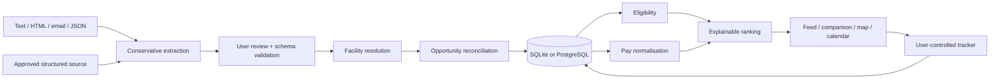

# Architecture

This first draft is a TypeScript modular monolith: Next.js/React at the edge of the application, a framework-independent domain layer, server-side extraction and collection, and a transactional persistence adapter. A single process is an appropriate starting point for one person's dataset; an always-running worker fleet is not required to use it.

## Domain boundaries

`model.ts` defines validated import/profile contracts and entities. `ingestion.ts` manages identity and history. `engine.ts` performs deterministic eligibility, financial arithmetic, date handling and scoring. Browser-side rescoring uses those same pure functions; a slider does not refetch or reparse advertisements.

The four conceptual levels remain distinct: advertisement, vacancy, recruiter terms and placement dates. Individual roster shifts are not yet a separate implemented entity. One multi-block message can become multiple source records through the reviewed import pathway; future extraction must preserve a parent-message identifier when this becomes automatic.

Professional credentials are declared facts, not inferred from the user's previous rotations. Required credentials known to be absent block suitability; an unconfirmed credential list produces verification. Registration categories are not assumed interchangeable. Restrictions and scoring never share a numerical threshold.

Scores normalise the weights of dimensions with known evidence. Unknown money is not zero attractiveness. The percentage shown as **scoring evidence** is criterion coverage, not an AI probability or a claim that every job detail is verified. Financial scores use comparable active offers only. Adventure is a declared preference/illustrative fixture, not measured biodiversity. Clinical interest measures specialty preference; it does not certify training value.

## Persistence

Tables: `schema_version`, `user_profiles`, `facilities`, `sources`, `opportunities`, `source_listings`, `recruiter_offers`, `user_job_actions`, `source_observations`, `collection_runs`, `review_queue`.

IDs and entity relationships are relational, with foreign keys and lookup indexes. Nested typed attributes are JSON text, identically represented in both backends. The one owner profile contains availability windows and ranking preferences. Monetary records use validated numeric values; the model has no tax engine.

SQLite uses WAL, foreign keys, a busy timeout and `BEGIN IMMEDIATE`, plus an in-process asynchronous write queue. PostgreSQL uses transactions and a locked owner row. Imports, merges, deletes, tracker changes and profile saves commit atomically. Revision snapshots retain prior source content and rates. Identical repeated observations update the observation timestamp without generating redundant history rows.

The current repository loads the small owner's dataset and upserts it transactionally. This is intentionally simple but **not designed for nationwide scale or multiple independent users**. Next steps before larger deployment: incremental repositories, pagination, extracted searchable columns, owner IDs on all private records, per-user authorisation, migration files, append-only action audit events and conflict-aware client updates. Do not reuse the owner lock as a permanent multi-user design.

## Collectors

Medrecruit and Ochre registry entries are wired to a generic JobPosting structured-data adapter. Those are **candidate adapters**, not validated live coverage. They do not crawl link graphs or bypass redirects/challenges. All other listed sources support manual imports only in this draft.

Every collector requires source-level permission evidence, the source enabled flag and the global server switch. A durable collection attempt timestamp prevents concurrent workers from bypassing the interval. Responses are restricted to two hard-coded HTTPS hosts, pinned after public IPv4 validation, with a 2 MB limit and timeout. The conservative robots gate stops on applicable exclusions rather than attempting a broad crawl. A transient server error receives one delayed retry. Failures retain historical records and record an error instead of claiming an empty vacancy feed.

Only new extraction candidates enter the review queue. No LLM receives source material. Repeated identical candidates do not accumulate. Source contribution counts measure observed/exclusive records, not national recall.

## Dates and uncertainties

Observation timestamps are UTC. Placements are local date-only intervals with an IANA facility timezone for expiry checks. Inclusive duration uses UTC arithmetic on date labels, avoiding daylight-saving 23/25-hour-day errors. Calendar overlaps indicate date overlap, not guaranteed shift conflict. New facilities inherit a state timezone default and need correction before exact shift-time support, especially NSW/WA timezone exceptions.

Advertised, pending verification, confirmed available, withdrawn and filled remain distinct source states. A single withdrawn recruiter offer cannot withdraw an active competing listing. Withdrawn/filled offers remain visible as evidence but cannot boost scores or satisfy travel-benefit filters.

## Extending without rewriting

The next high-value seam is `Extraction`: add fixture-tested agency/email adapters that emit the validated listing contract, rather than making UI code parse source text. Next, replace source-state snapshots with incremental SQL queries as volume grows. The deterministic domain functions and their acceptance tests should remain stable across those changes.
